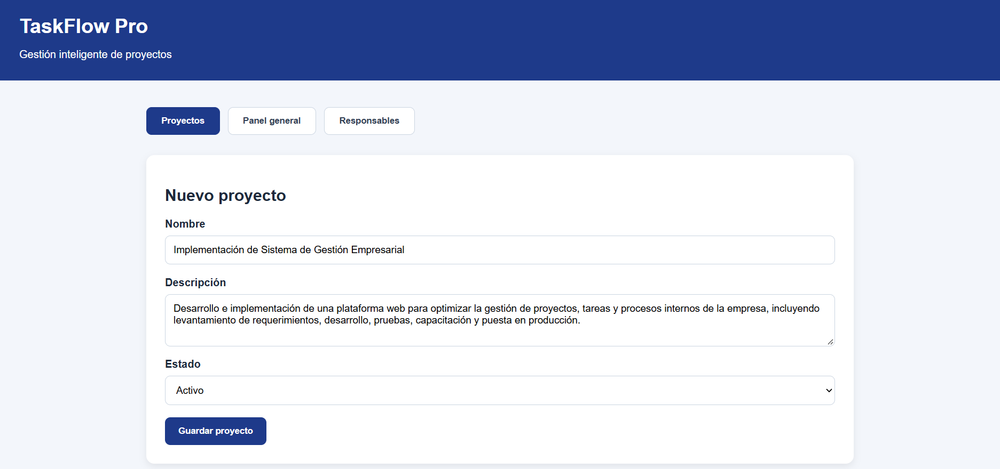
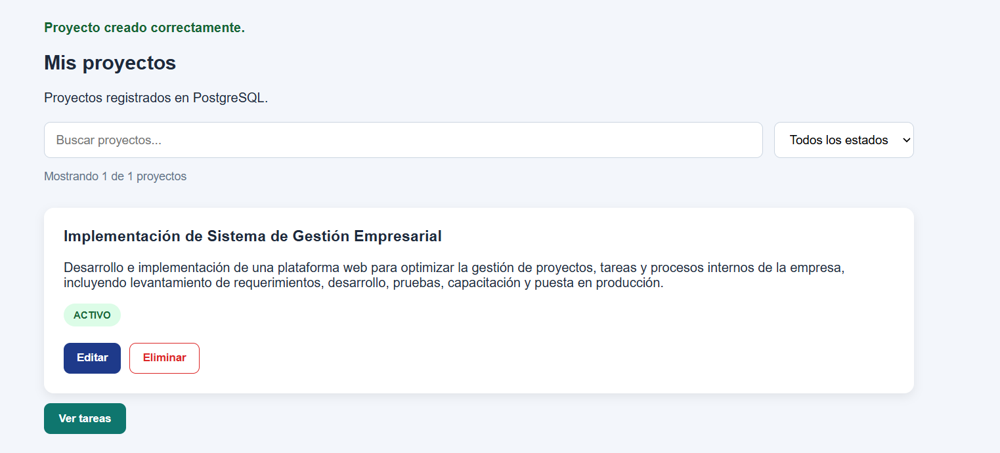
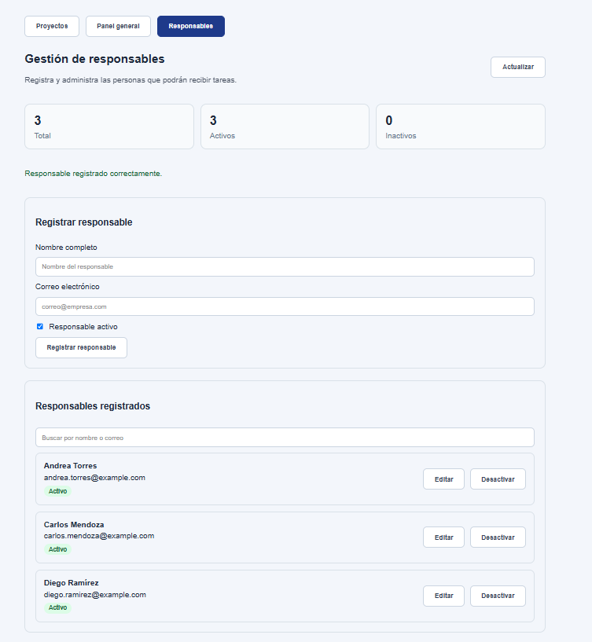
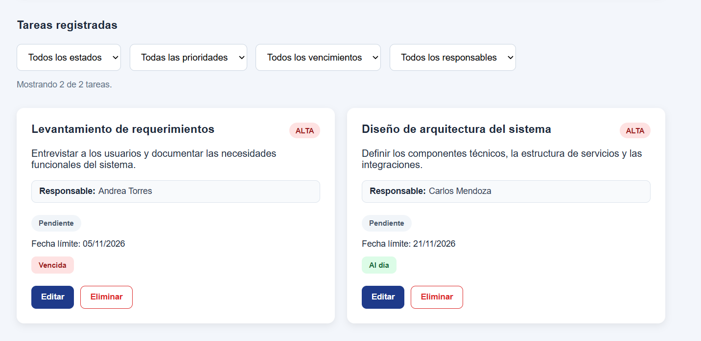

# TaskFlow Pro 1.0

Aplicación web para la gestión de proyectos, tareas y responsables.

## Tecnologías

- Backend: Java, Spring Boot y Maven
- Base de datos: PostgreSQL
- Frontend: React y Vite
- Control de versiones: Git y GitHub

## Funcionalidades

- Crear, consultar, editar y eliminar proyectos.
- Crear, consultar, editar y eliminar tareas.
- Administrar responsables activos e inactivos.
- Asignar responsables a tareas.
- Filtrar tareas por proyecto, estado, prioridad y responsable.
- Visualizar tareas en lista y tablero Kanban.
- Cambiar estados arrastrando tarjetas.
- Consultar alertas de vencimiento.
- Visualizar indicadores generales y por responsable.
- Consultar porcentajes de tareas finalizadas.

## Requisitos

- Java compatible con el proyecto.
- Node.js y npm.
- PostgreSQL.
- Base de datos llamada taskflow_db.
- Usuario de PostgreSQL configurado en el backend.

## Iniciar el backend

Abrir PowerShell en la carpeta backend.

Configurar la contraseña de PostgreSQL:

    $env:DB_PASSWORD = Read-Host "Contraseña de PostgreSQL"

Ejecutar:

    .\mvnw.cmd spring-boot:run

API disponible en:

    http://localhost:8080/api

Swagger:

    http://localhost:8080/swagger-ui.html

## Iniciar el frontend

Abrir otra terminal en la carpeta frontend.

La primera vez:

    npm install

Iniciar:

    npm run dev

Abrir:

    http://localhost:5173

## Ejecutar pruebas

Backend, desde su carpeta:

    $env:DB_PASSWORD = Read-Host "Contraseña de PostgreSQL"
    .\mvnw.cmd test

Frontend, desde su carpeta:

    npm run build

## Base de datos

Motor: PostgreSQL

Nombre de la base:

    taskflow_db

La base de datos contiene la información de proyectos,
tareas y responsables.

Importante: el código fuente de GitHub no sustituye
un respaldo de PostgreSQL.

## Seguridad

No almacenar contraseñas en GitHub.

La contraseña de PostgreSQL se proporciona mediante
la variable de entorno DB_PASSWORD.

## Estado del proyecto

Versión: 1.0

Etapas funcionales e integrales completadas: 44 de 45.

La versión 1.0 corresponde al alcance funcional local
desarrollado y probado.

La autenticación, los permisos por usuario y el despliegue
público no forman parte de este alcance.

## Capturas de pantalla

### Registro de proyectos

### Gestión de proyectos

### Administración de responsables

### Gestión y seguimiento de tareas

## Repositorio

https://github.com/PaulCabreraMurillo/TaskFlowPro
